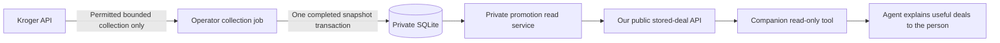

# Private promotion database service

Run one private service to let companion agents discover stored locations and
completed topics, find collected deals, check
regular prices, estimate quantities and read dated history without contacting
Kroger. The service owns the SQLite history
database and its permission rules. It does not fetch a catalog or save shopper
searches.

**Actual Kroger permission to retain and share these observations has not been
established.** A new installation returns `permission_required`. Successful
software tests use synthetic data in temporary databases; they do not grant
source rights or produce real promotion history.

The missing basis concerns systematic collection and reuse of retained data;
Partner enrollment is not a blanket requirement for apps or agents and does not
itself authorize that database. The human app's separate live Public lookups can
proceed within their published terms. See the [permission guide](KROGER_PERMISSION_REQUEST.md)
for the exact restriction and the specific exception to ask about.

## How data reaches an agent



Collection and reading are independent. Only the separately configured operator
job contacts Kroger for stored data. It records exact store/topic, collection
time, original source permission and bounded coverage. A completed job, including
an empty sample, can replace that topic's previous snapshot. Partial/failed jobs
cannot publish partial deals or refresh an old snapshot's date. Operator job
identity makes a completed scheduled bucket idempotent. Collection retries are
disabled by default; an operator can enable at most three attempts, governed by
durable quota reservations, backoff and a source lease. See the
[collection limits and recovery guide](HISTORY.md#limits-and-recovery).

The companion's `promotions.py` stores/topics/latest/price/estimate/status/history
requests query our stored data only. They
need neither a Kroger credential nor a database file. Empty, stale, unavailable
and permission-blocked results remain explicit and never trigger a live source
fetch. The human page and the companion's explicit current-shopping tools have
a separate live-price path; ordinary shopping does not collect history.
The database remains empty/pending until real source
permission and a deliberate operator collection are configured.

An agent can recommend useful discounts or lower whole-package outlays among
the fresh returned sample. It must keep package sizes, collection time, coverage
and unknown units clear, rather than claiming storewide cheapest prices or live
checkout validation. The [companion plugin](https://github.com/aipersonalized/houston-i-love-kroger-plugin)
has its own repository and release; it connects through this app's API.

## 1. Prepare the installation

1. Complete [the installation guide](SELF_HOSTING.md) through dependency setup.
   Use the project's supported Node.js version and `npm ci --ignore-scripts`.
2. Choose a private local folder for the database. Set `HISTORY_DB_PATH` in the
   service's private environment to that file. The default is
   `.runtime/history.sqlite` relative to the installed project. Existing database
   files must pass the schema and integrity checks; arbitrary SQLite files and
   linked paths are refused.
3. Use your password manager or secret manager to generate a fresh random service
   secret. Store it as `PROMOTION_SERVICE_TOKEN` in the service and app runtime
   environments. It must be 32–512 printable ASCII characters with no spaces.
   Keep it out of browser configuration, chat, command arguments, screenshots,
   source control and agent instructions. This is a private app-to-service
   secret, separate from Kroger API credentials.
4. Leave `PROMOTION_SERVICE_HOST` unset for the default `127.0.0.1` listener.
   Leave `PROMOTION_SERVICE_PORT` unset for port `4174`. For separate containers,
   bind the service to its private container interface and restrict access to
   the app and operator network. Do not publish its port to the Internet.
   Use an authenticated, encrypted transport across any untrusted network.
5. Keep one authority for this database volume. In a service deployment, mount it
   only in the promotion service and its authorized operator jobs. The web app
   uses HTTP and does not mount a second database copy or open the volume itself.

The listener refuses to start without a valid secret, including when configured
for an external interface. A configured secret alone does not configure a
firewall, TLS, encrypted disks or backup access controls.

## 2. Start the service

From the project folder, with private environment settings prepared, run:

```text
node --env-file-if-exists=.env src/promotion-server.js
```

The expected message is `Private promotion service is listening. Source
permission is checked separately.` Keep that terminal open. Stop it with Ctrl+C.
The process closes its listener and database; active connections receive a
bounded shutdown window.

For a liveness check, open `http://127.0.0.1:4174/healthz` on the service machine.
It returns only `{"ok":true}`. It does not establish source permission, database
coverage or live Kroger access. All `/v1/` operations require the private token.
There is no browser sign-in screen or public policy-enabling operation.

## 3. Connect the web app

1. Set `PROMOTION_SERVICE_URL` in the app's private runtime environment to the
   service origin, such as `http://127.0.0.1:4174`. In separate containers, use the
   service's private DNS name. The URL may use HTTP or HTTPS; it cannot include
   credentials, a path, a query or a fragment.
2. Give the app the same private `PROMOTION_SERVICE_TOKEN`. The app backend adds
   the authentication header; browsers and companion agent tools do not receive
   this token.
3. Start the app as described in [self-hosting](SELF_HOSTING.md). Select a store,
   then use its stored-observation search or the documented public app API.
4. Expect `permission_required` until the operator has actual reviewed permission.
   An available search with zero observations means only that the permitted,
   retained sample has no matching rows. A failed service connection remains
   unavailable; it is never reported as an empty history.

The client makes no automatic retries and keeps no result cache. It limits the
whole request, including streamed response bytes, to five seconds by default and
caps responses at 2 MiB. Redirects are refused so the private token is not
forwarded to another destination. Production observations must not be mixed with
certification responses.

## 4. Collect and maintain data through the operator workflow

Follow [history operations](HISTORY.md) for actual reviewed permission, finite
store/topic plans, bounded collection, revocation and retention cleanup. Run those
operator commands in the service's storage environment against its authoritative
`HISTORY_DB_PATH`, with its private source configuration. Do not collect the same
plan concurrently or create another independently writable database copy for the
app.

The existing operator CLI remains the write interface. It can record a reviewed
policy and collect only within approved stores, topics, purposes and expiry.
No HTTP operation imports observations, enables permission, changes policy,
starts collection, runs SQL or accepts a database path. Shopper searches,
selected ZIP codes, customer identities, request bodies and authentication
headers are not retained by this service. Configure any surrounding proxies and
supervisors to preserve that logging boundary.

Every read checks both the original grant and the current grant: collection,
display and agent-access purposes; exact selected store; collection-job topic;
grant dates; row retention; and the shorter applicable retention period. Reads
also require consistent, completed collection provenance. Renewing permission
cannot revive an expired original grant or a shortened row retention deadline.
Current scope narrowing and revocation take effect on subsequent reads, including
later pages from an older search. Source-policy evidence references and private
storage fields are never returned.

Expired or revoked rows are filtered immediately but are physically removed
only by the operator purge. SQL deletion does not guarantee erasure from SQLite
free pages, WAL files, backup copies or storage devices.

## 5. Private HTTP contract

### Latest collected deals

Authenticated `POST /v1/deals/search` accepts `locationId`, exact approved
`topic`, optional `limit` (default20,max50) and a matching opaque `cursor`.
The app exposes it as `POST api/v1/promotions/latest`; only the app backend
sends the private service token. The full DTO and snapshot lifecycle are in
[the latest-deal contract](API.md#latest-collected-deals).

The service selects the newest complete store/topic snapshot before filtering
promotions. Newer regular-only, unavailable and unsupported-price facts suppress
an older promotion; a complete empty sample replaces that topic's old sample.
`available` with zero deals, `no_data`, `stale` and `permission_required` have
different meanings. Historical observations are queried separately and never
silently substituted for current deals.

`PROMOTION_MAX_AGE_SECONDS` is the operator-only maximum snapshot age, default
86400 (24hours), range1–604800 seconds. A consumer cannot override it. A failed
collection leaves the last completed data with its real age and fixed attempt
status. Original/current grants, retention and expiry can exclude a snapshot
before that age limit. No price is guaranteed valid until checkout.

### Price checks and quantity estimates

`POST /v1/prices/search` accepts the same exact store/topic, optional exact
`productId` and `itemId`, and bounded page fields. It returns `products` from the
latest completed sample, preserving regular-only and unavailable source facts.
The app exposes `POST api/v1/promotions/prices`. See the
[price-check contract](API.md#check-collected-prices).

`POST /v1/basket/estimate` accepts one exact `locationId` and 1–10 `items`, each
with an exact approved `topic`, returned `productId`, returned `itemId` and whole
`quantity` 1–99. One database read transaction resolves the latest completed
snapshots. Caller-supplied prices are rejected; no item substitution, list
persistence, customer account or source request occurs. The app exposes
`POST api/v1/promotions/estimate`. See the
[estimate contract](API.md#estimate-a-shopping-list-from-collected-prices).

Keep `reportedSubtotalCents` separate from `qualifiedSubtotalCents`. Unknown
currency can support only an explicitly unqualified numeric reported sum without
a currency symbol. Different currencies, or mixed known/unknown currencies,
cannot be summed. Unknown units, variable weight and missing/stale/unavailable
items stay unresolved. `complete` means all line arithmetic was possible; it
does not certify purchase conditions or a payable checkout total. Source facts,
observation time, gaps and exclusions remain in the response.

All data operations require `Authorization: Bearer …`, where the runtime supplies
the actual private secret. Send POST bodies as uncompressed `application/json`.
Responses use JSON and `Cache-Control: no-store`. The private service has no
cross-origin browser access. The app's public proxy operations and their normal
response wrapper are documented separately in [API.md](API.md).

| Operation | Request | Result |
|---|---|---|
| `GET /healthz` | No authentication required | Only `{"ok":true}` |
| `GET /v1/status` | Private authentication | `status`, optional `reason` and `message`, `coverage` |
| `POST /v1/deals/search` | Exact store/topic, optional bounded page | Fresh qualified `deals`, `snapshot`, `latestAttempt`, `page`, `coverage` |
| `POST /v1/prices/search` | Exact store/topic, optional exact IDs and bounded page | Collected `products` with pricing availability and source context |
| `POST /v1/basket/estimate` | Exact store and 1–10 requested item/quantity lines | Per-line amounts or unresolved reasons, reported/qualified subtotals and exclusions |
| `POST /v1/promotions/search` | Search fields below | `status`, `locationId`, `observations`, `page`, `coverage` |
| `POST /v1/promotions/retrieve` | Exact `locationId` and `observationId` string | `status`, `locationId`, one `observation` or `null`, `coverage` |
| `POST /v1/history/compare` | Exact `locationId` and up to 500 current `offers` | Existing `status`, `histories`, optional `reason`/`message` comparison contract |

Search fields:

| Field | Meaning |
|---|---|
| `locationId` | Required full eight-character alphanumeric store ID; preserve leading zeros |
| `term` | Optional literal substring of the retained description or brand, 1–80 characters; ASCII case-insensitive matching; `%` and `_` have no wildcard meaning |
| `productId`, `itemId` | Optional exact opaque source identifiers, up to 100 characters |
| `observedFrom`, `observedTo` | Optional inclusive observation timestamps in UTC ISO format, such as `2026-01-04T12:00:00Z`; the start cannot follow the end |
| `limit` | Whole number 1–50; default 20 |
| `cursor` | Opaque `page.nextCursor` from the same store, filters and limit |

Optional text fields must have no surrounding whitespace or control characters.
Omit unused fields. Remote callers cannot choose a source, override the service's
current permission-check clock or supply administrative controls. Unknown body
fields are rejected.

Search returns all matching authorized observations, including regular-only or
zero-valued source facts. Each row labels whether it contains a reported
promotion; do not present every stored row as a verified current deal.

`page` contains `limit`, `returned`, `truncated` and `nextCursor`. When truncated,
submit the same fields with the returned cursor to read the next page. Order is
newest observation first, with observation ID breaking ties. Pagination keeps
the first page's insertion/time boundary across restarts. Each page checks current
rights and retention again, so a later page can contain fewer rows after expiry,
revocation or purge. Start a new search to include new observations.

Each observation contains:

- `observationId` as a positive decimal string; use this exact ID for retrieval.
- Exact `sourceId`, public `sourceLabel`, `locationId`, `productId` and `itemId`.
- Nullable source `description`, `brand`, `size`, `soldBy`, `currency`,
  `priceBasis`, `modality`, `eligibilityKey` and `unitBasis`.
- `price` with nullable `regular`, `promo`, integer `regularCents` and
  `promoCents`, source unit estimates, and source `effectiveDate`/`expirationDate`
  objects. No currency or measurement unit is inferred.
- `observedAt`, `dateQualification` (`qualified` or `unqualified`), and
  `promotionStatus` (`reported_promotion` or `not_verified_promotion`). Date
  qualification concerns the price window at observation time; it does not
  promise that an old offer is valid now. A source zero is preserved without a
  claim that the item is free.

All operations report bounded sample coverage, not a complete catalog or all-time
history. `permission_required` is distinct from available data with no matches.
Retrieval returns `not_found` for an unknown, wrong-store, expired or inaccessible
observation while the source itself remains permitted. Its response does not
reveal whether an excluded row still exists. General source or selected-store
permission failure returns `permission_required`.

Malformed input produces HTTP 400; authentication 401; missing routes 404;
wrong methods 405; body timeout 408; oversize bodies 413; unsupported content 415;
admission/rate limits 429; and storage failures 503. Errors have only
`{"error":{"code":"…","message":"…"}}`, with fixed safe messages. No SQL,
filesystem paths, source-policy evidence, raw upstream failures or tokens are
included.

Default service bounds are 1 MiB per request body, five seconds to finish a body,
8 active requests, 120 authenticated requests per minute, 8 KiB headers,
64 connections and 100 requests per connection. Listener/header and socket
timeouts also bound idle clients. SQLite operations are synchronous and use the
existing five-second lock wait; these limits are not a measured production
capacity guarantee. Keep collection plans finite and avoid overlapping jobs.

## 6. Embed the supported interfaces

`createPromotionService({store, token, ...})` from
`src/promotion-service.js` returns a configured Node HTTP server. Its caller owns
listening, shutdown and the supplied store. The standalone
`src/promotion-server.js` entrypoint opens and closes that store itself.

`createPromotionClient({url, token, ...})` from `src/promotion-client.js` exposes
async `getStatus()`, `searchPromotions(input)`, `retrievePromotion(input)` and
`getComparisons({locationId, offers})`. The comparison method fits the app's
existing history-provider interface. It uses the service's current clock,
regardless of a consumer's local comparison timestamp. Use installation-owned
runtime values; do not embed secrets in a script or skill.

## 7. Upgrade, recover and troubleshoot

1. Before a database upgrade, stop collection and service writes and take a
   consistent private backup using [the backup guidance](SELF_HOSTING.md#7-back-up-upgrade-and-recover).
2. Stop all collectors and service processes before changing the authoritative
   file. Start the new service against it. Schema version 4 adds
   snapshot authority/retention, target scope, availability and price qualification
   after version3's nullable description/brand and paging index.
   Version 5 adds durable collector lease, request reservations and backoff;
   it changes no supplier facts or grants. Version 6 adds separately permitted
   directory snapshots and nullable labels for new product jobs. Known version
   1, 2, 3, 4 or 5 databases
   are verified before migration. Their old prices and identifiers remain
   unchanged; missing descriptions stay missing. Do not run mixed-version
   collectors: an already-open older process cannot enforce the new lease.
   Old rows can still be found by exact IDs when their provenance and rights
   permit it. Text search does not invent old descriptions or topic labels.
3. Recheck liveness, authenticated status and a permitted exact-store task.
   Stop if integrity or schema checks fail. Do not rename an unrelated file to
   make it look like this database.
4. An older app version cannot open schema 6. For rollback, stop the new service
   and restore a compatible, consistent private backup with its matching app
   version. There is no in-place schema downgrade. Account for data collected
   since the backup and its retention/revocation obligations.

If startup fails, check that the private secret is present, the port is free and
the service identity can access the intended regular local file. If the app
reports unavailable, check the private service URL, paired secret, listener and
network route. If it reports `permission_required`, review the actual source
rights rather than editing a sample policy to bypass the gate. If a permitted
search has no matches, check the exact store/IDs, time filters, sample coverage,
retention and whether old rows lack descriptions.

Focused local verification uses temporary synthetic databases and local HTTP:

```text
node --test tests/history-store.test.js tests/promotion-store.test.js tests/promotion-service.test.js tests/promotion-client.test.js
```

These checks cover schema migration, restart persistence, filters, pagination,
rights changes, authentication, safe failures, resource bounds, client deadlines
and the independent server entrypoint. They do not exercise a live source,
production database, actual source agreement or deployed container network.

Protocol and migration references: [Node.js HTTP](https://nodejs.org/download/release/v22.21.0/docs/api/http.html),
[constant-time comparison](https://nodejs.org/docs/latest-v22.x/api/crypto.html#cryptotimingsafeequala-b)
and [SQLite ALTER TABLE](https://www.sqlite.org/lang_altertable.html).

## Stored directory and completed topics

The same private service provides two additional read-only operations:

| Method/path | Exact input | Database operation |
| --- | --- | --- |
| `POST /v1/stores/search` | `{ "zipCode": "00000" }` | `getStoredStores`; independently permitted completed ZIP query. |
| `POST /v1/topics/search` | `{ "locationId": "TEST0001" }` | `getStoreTopics`; readable completed named topics for that exact store. |

These are synthetic values. Public consumers use the app's
[`api/v1/promotions/stores` and `topics`](API.md#stored-store-discovery) proxy,
with the same private authentication, request limits, fixed errors, no-cache and
whole-response deadline as other service reads. Neither endpoint calls Kroger,
reads private operator configuration, changes policy or starts collection.

`stores` returns a completed first-page ZIP query under separately reviewed
directory rights: fixed ten-mile radius, at most ten source results, exact
query/time, nullable store metadata and `completeNearbyStores: false`. It does
not establish a nearest-store order or every nearby location. Show the results
and let the person choose the exact store; then discover completed topics.
Current-price and Cart workflows remain separate from these companion reads.

`topics` lists only completed samples with an explicit stored label and original
and current product-history permission. It returns fresh/stale snapshot state
and raw product-result count; zero denotes a completed empty sample. Failed or
running attempts do not introduce labels or refresh completed times. Configured
but uncollected targets and private policy references are not exposed. Legacy
topic hashes are not reversed or matched to current private configuration.

Directory-source permission and product-source permission are independent. A
product `status` response cannot grant directory access or reveal directory
policy. Directory rows can be usable while topics/deals are permission-blocked,
and the reverse can occur. The source starts pending; only the separate private
[`stores:collect` operator task](HISTORY.md#collect-a-stored-zip-directory-separately)
can populate it under an actual reviewed grant. Initialization, source access
and the CLI recipient acknowledgement grant no storage/display/agent rights.

Schema 6 adds directory rights, attempts, snapshots and bounded store rows,
plus nullable labels for new completed product jobs. It leaves old facts,
permissions and unknown labels intact. Verified schemas 1–5 migrate
transactionally; earlier migration files stay unchanged. Stop every older app,
service and operator process before opening the authoritative file with this
version. Newly opened older code refuses schema 6, while an already-open older
writer does not know all new metadata and policy rules. Do not mix versions.
Keep its matching consistent stopped-state backup and code for rollback; there
is no in-place downgrade. Migration does not begin source collection.
