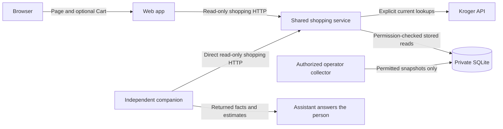

# Shared shopping and promotion service

The web app and independently released companion use this service for nearby
stores, current products, reported deals, exact product checks and quantity
estimates. The companion calls it directly and returns its answer in the
conversation; it needs no web page, app process, supplier secret or database.
The same service owns the permission-checked promotion database.

Live shopping and stored reads remain explicit. Live operations contact Kroger
transiently; stored operations never contact Kroger, collect, refresh or fall
back to a live lookup. Shopping never writes history.

**Actual Kroger permission to retain and share observations has not been
established.** A new installation returns `permission_required`. Successful
software checks use synthetic data in temporary databases. Read the
[permission guide](KROGER_PERMISSION_REQUEST.md) before collection. Ordinary
permitted Public current-price lookup does not itself require Partner enrollment.

## How the independent clients connect

This view covers request ownership. Collection remains a separate operator action.



`src/shopping-api.js` owns the headless operations. It reads no UI assets and
creates no Cart sessions. `src/promotion-server.js` starts the shared service;
`src/server.js` starts the web app, which uses `SHOPPING_SERVICE_URL` for shopping
and retains browser assets and optional Cart. Service failure is unavailable,
with no web-to-supplier fallback.

The companion's separate `promotions.py` commands read saved ZIP-query stores,
completed topics, latest deals, prices, estimates and dated history only. A
missing or stale result does not contact a supplier or schedule collection.
The database remains pending until real source permission and a deliberate
operator collection are configured. A bounded sample never establishes every
store promotion, the cheapest storewide price or verified checkout conditions.

## 1. Prepare the installation

1. Follow [self-hosting](SELF_HOSTING.md) through Node.js and dependency setup.
   Copy `.env.example` to private `.env` beside `package.json`.
2. Choose the private authoritative `HISTORY_DB_PATH`; blank uses
   `.runtime/history.sqlite`. Only this service and separately authorized
   operator jobs open that volume. The web app opens no database.
3. Generate a private random secret in your password or secret manager. Save it
   as `PROMOTION_SERVICE_TOKEN` in the service runtime environment. It must have
   32–512 printable ASCII characters without spaces. Never put it in a URL,
   command argument, browser setting, assistant prompt, log or public source.
   It protects private `/v1/*`; normal shopper clients need no service token.
4. Keep `PROMOTION_SERVICE_HOST=127.0.0.1` and
   `PROMOTION_SERVICE_PORT=4174` for local use. Keep the raw port private. Across
   untrusted networks use authenticated encrypted transport.
5. Leave `SHOPPING_SERVICE_BASE_PATH=/` for the local public API base, or choose
   a simple prefix beginning and ending with `/`. Set `SHOPPING_PUBLIC_ORIGIN`
   to the exact accepted HTTP(S) origin for a proxy or nonloopback listener.
   Configure proxy Host forwarding to that origin or the loopback listener.
   For an internal container origin such as `http://promotions:4174`, the proxy
   must send `Host: promotions:4174`. Native companion calls omit Origin;
   the human page uses its own web gateway.
6. Supply permitted `KROGER_CLIENT_ID`, `KROGER_CLIENT_SECRET` and
   `KROGER_ENVIRONMENT` to this service for current shopping. Blank credentials
   allow status and return setup-required for live searches. Certification
   never reads production history. Optional web Cart retains separately enabled
   credentials, grants and sessions.

## 2. Start and check the service

From the project folder, run:

```text
npm run promotions:serve
```

The expected message starts `Shared shopping service is listening` and confirms
public read routes plus private authenticated storage routes. Keep that terminal
open. Stop it with Ctrl+C. The process drains its listener and closes the database.

Open `http://127.0.0.1:4174/healthz` locally for the minimal `{"ok":true}`
liveness result. Then use `http://127.0.0.1:4174/api/v1/status` for public status.
It includes `service: {"name":"houston-i-love-kroger-shopping","apiVersion":1}`
and `X-Houston-Service: houston-i-love-kroger-shopping`. Status never contacts
Kroger and grants no source rights. Blank supplier credentials return
`configured: false`; storage remains independently permission-gated.

Public `api/v1/*` uses the wrapped contract in [API.md](API.md). Private `/v1/*`
retains its Bearer token, database-only meaning and unwrapped responses. Public
`api/v1/deals/search` is live; private `/v1/deals/search` reads stored latest
deals. These route families are not interchangeable. The dedicated service has
no page, assets, Cart, OAuth callback, collection or arbitrary supplier-proxy route.

## 3. Connect each independent client

1. Set `SHOPPING_SERVICE_URL=http://127.0.0.1:4174/` in the web app environment
   for the default local service. Include its configured prefix if one is used.
   It must end with `/` and cannot include credentials, a query or fragment.
   Use HTTPS across untrusted networks. Container HTTP requires a trusted private
   network and an accepted internal Host.
2. Start the web app in another terminal using `npm start`. It needs neither
   the private `/v1/*` token nor database access. It creates no supplier shopping
   client, and a service outage has no local supplier fallback.
3. Install the [independent companion](https://github.com/aipersonalized/houston-i-love-kroger-plugin)
   using its own guide. Point `HOUSTON_SERVICE_URL` or `--base-url` at the same
   dedicated service base. It requires the dedicated header on API responses
   and the status identity; a web-page address is rejected. No web app needs to run.
4. Check status, choose an exact returned store and request one bounded product
   search. Preserve source facts, coverage and retrieval time. Stored permission,
   missing data, stale data and transport failures remain separate results.
5. For public hosting, forward only the public read route allowlist under a
   dedicated HTTPS service prefix. Keep `/v1/*`, `healthz`, the raw port, storage
   and operator controls private. The service checks Host and Origin, accepts at
   most 4,096 JSON bytes, 30 public requests per minute including status and four
   active requests, and cancels after 35 seconds. These process-local limits reset
   on restart and do not prove production capacity or the supplier quota balance.

The web service client has a 30-second whole-response deadline and 8 MiB cap,
including streamed bytes. It refuses redirects, cookies, caching and retries.
The older private storage client retains its five-second/2 MiB bounds and token.
The companion's independent release declares its client bounds. Only dedicated
status adds JSON identity; all other public success schemas remain unchanged.
The web app omits the dedicated header and status discriminator.

Keep customer queries, responses and secrets out of proxy and process logs.
No shopper-search logging is built into this service. An assistant recipient
still needs applicable source permission; installation creates no such rights.

`LOCAL_SHOPPING_MODE=true` is an explicit development alternative. It is rejected
with a nonlocal HOST, PUBLIC_ORIGIN or SHOPPING_SERVICE_URL. It reuses the same
headless implementation locally and can optionally use the older private stored
client or local history comparisons. It is unavailable for public web hosting.

## 4. Collect and maintain data through the operator workflow

Follow [history operations](HISTORY.md) for actual reviewed permission, finite
store/topic plans, bounded collection, revocation and retention cleanup. Run those
operator commands in the service's storage environment against its authoritative
`HISTORY_DB_PATH`, with its private source configuration. Do not collect the same
plan concurrently or create another independently writable database copy for the
app.

The existing operator CLI remains the write interface. It can record a reviewed
policy and collect only within approved stores, topics, purposes and expiry.
No HTTP operation imports observations, enables permission, changes policy,
starts collection, runs SQL or accepts a database path. Shopper searches,
selected ZIP codes, customer identities, request bodies and authentication
headers are not retained by this service. Configure any surrounding proxies and
supervisors to preserve that logging boundary.

Every read checks both the original grant and the current grant: collection,
display and agent-access purposes; exact selected store; collection-job topic;
grant dates; row retention; and the shorter applicable retention period. Reads
also require consistent, completed collection provenance. Renewing permission
cannot revive an expired original grant or a shortened row retention deadline.
Current scope narrowing and revocation take effect on subsequent reads, including
later pages from an older search. Source-policy evidence references and private
storage fields are never returned.

Expired or revoked rows are filtered immediately but are physically removed
only by the operator purge. SQL deletion does not guarantee erasure from SQLite
free pages, WAL files, backup copies or storage devices.

## 5. Private HTTP contract

### Latest collected deals

Authenticated `POST /v1/deals/search` accepts `locationId`, exact approved
`topic`, optional `limit` (default20,max50) and a matching opaque `cursor`.
The shared service exposes the same database operation publicly as
`POST api/v1/promotions/latest` under its own permission checks; shoppers never
send the private storage token. The full DTO and snapshot lifecycle are in
[the latest-deal contract](API.md#latest-collected-deals).

The service selects the newest complete store/topic snapshot before filtering
promotions. Newer regular-only, unavailable and unsupported-price facts suppress
an older promotion; a complete empty sample replaces that topic's old sample.
`available` with zero deals, `no_data`, `stale` and `permission_required` have
different meanings. Historical observations are queried separately and never
silently substituted for current deals.

`PROMOTION_MAX_AGE_SECONDS` is the operator-only maximum snapshot age, default
86400 (24hours), range1–604800 seconds. A consumer cannot override it. A failed
collection leaves the last completed data with its real age and fixed attempt
status. Original/current grants, retention and expiry can exclude a snapshot
before that age limit. No price is guaranteed valid until checkout.

### Price checks and quantity estimates

`POST /v1/prices/search` accepts the same exact store/topic, optional exact
`productId` and `itemId`, and bounded page fields. It returns `products` from the
latest completed sample, preserving regular-only and unavailable source facts.
The shared service exposes `POST api/v1/promotions/prices`. See the
[price-check contract](API.md#check-collected-prices).

`POST /v1/basket/estimate` accepts one exact `locationId` and 1–10 `items`, each
with an exact approved `topic`, returned `productId`, returned `itemId` and whole
`quantity` 1–99. One database read transaction resolves the latest completed
snapshots. Caller-supplied prices are rejected; no item substitution, list
persistence, customer account or source request occurs. The shared service exposes
`POST api/v1/promotions/estimate`. See the
[estimate contract](API.md#estimate-a-shopping-list-from-collected-prices).

Keep `reportedSubtotalCents` separate from `qualifiedSubtotalCents`. Unknown
currency can support only an explicitly unqualified numeric reported sum without
a currency symbol. Different currencies, or mixed known/unknown currencies,
cannot be summed. Unknown units, variable weight and missing/stale/unavailable
items stay unresolved. `complete` means all line arithmetic was possible; it
does not certify purchase conditions or a payable checkout total. Source facts,
observation time, gaps and exclusions remain in the response.

All private `/v1/*` data operations require `Authorization: Bearer …`, where the runtime supplies
the actual private secret. Send POST bodies as uncompressed `application/json`.
Responses use JSON and `Cache-Control: no-store`. The private service has no
cross-origin browser access. The public shopping operations and their normal
response wrapper are documented separately in [API.md](API.md).

| Operation | Request | Result |
|---|---|---|
| `GET /healthz` | No authentication required | Only `{"ok":true}` |
| `GET /v1/status` | Private authentication | `status`, optional `reason` and `message`, `coverage` |
| `POST /v1/deals/search` | Exact store/topic, optional bounded page | Fresh qualified `deals`, `snapshot`, `latestAttempt`, `page`, `coverage` |
| `POST /v1/prices/search` | Exact store/topic, optional exact IDs and bounded page | Collected `products` with pricing availability and source context |
| `POST /v1/basket/estimate` | Exact store and 1–10 requested item/quantity lines | Per-line amounts or unresolved reasons, reported/qualified subtotals and exclusions |
| `POST /v1/promotions/search` | Search fields below | `status`, `locationId`, `observations`, `page`, `coverage` |
| `POST /v1/promotions/retrieve` | Exact `locationId` and `observationId` string | `status`, `locationId`, one `observation` or `null`, `coverage` |
| `POST /v1/history/compare` | Exact `locationId` and up to 500 current `offers` | Existing `status`, `histories`, optional `reason`/`message` comparison contract |

Search fields:

| Field | Meaning |
|---|---|
| `locationId` | Required full eight-character alphanumeric store ID; preserve leading zeros |
| `term` | Optional literal substring of the retained description or brand, 1–80 characters; ASCII case-insensitive matching; `%` and `_` have no wildcard meaning |
| `productId`, `itemId` | Optional exact opaque source identifiers, up to 100 characters |
| `observedFrom`, `observedTo` | Optional inclusive observation timestamps in UTC ISO format, such as `2026-01-04T12:00:00Z`; the start cannot follow the end |
| `limit` | Whole number 1–50; default 20 |
| `cursor` | Opaque `page.nextCursor` from the same store, filters and limit |

Optional text fields must have no surrounding whitespace or control characters.
Omit unused fields. Remote callers cannot choose a source, override the service's
current permission-check clock or supply administrative controls. Unknown body
fields are rejected.

Search returns all matching authorized observations, including regular-only or
zero-valued source facts. Each row labels whether it contains a reported
promotion; do not present every stored row as a verified current deal.

`page` contains `limit`, `returned`, `truncated` and `nextCursor`. When truncated,
submit the same fields with the returned cursor to read the next page. Order is
newest observation first, with observation ID breaking ties. Pagination keeps
the first page's insertion/time boundary across restarts. Each page checks current
rights and retention again, so a later page can contain fewer rows after expiry,
revocation or purge. Start a new search to include new observations.

Each observation contains:

- `observationId` as a positive decimal string; use this exact ID for retrieval.
- Exact `sourceId`, public `sourceLabel`, `locationId`, `productId` and `itemId`.
- Nullable source `description`, `brand`, `size`, `soldBy`, `currency`,
  `priceBasis`, `modality`, `eligibilityKey` and `unitBasis`.
- `price` with nullable `regular`, `promo`, integer `regularCents` and
  `promoCents`, source unit estimates, and source `effectiveDate`/`expirationDate`
  objects. No currency or measurement unit is inferred.
- `observedAt`, `dateQualification` (`qualified` or `unqualified`), and
  `promotionStatus` (`reported_promotion` or `not_verified_promotion`). Date
  qualification concerns the price window at observation time; it does not
  promise that an old offer is valid now. A source zero is preserved without a
  claim that the item is free.

All operations report bounded sample coverage, not a complete catalog or all-time
history. `permission_required` is distinct from available data with no matches.
Retrieval returns `not_found` for an unknown, wrong-store, expired or inaccessible
observation while the source itself remains permitted. Its response does not
reveal whether an excluded row still exists. General source or selected-store
permission failure returns `permission_required`.

Malformed input produces HTTP 400; authentication 401; missing routes 404;
wrong methods 405; body timeout 408; oversize bodies 413; unsupported content 415;
admission/rate limits 429; and storage failures 503. Errors have only
`{"error":{"code":"…","message":"…"}}`, with fixed safe messages. No SQL,
filesystem paths, source-policy evidence, raw upstream failures or tokens are
included.

Default private storage bounds are 1 MiB per request body, five seconds to finish a body,
8 active requests, 120 authenticated requests per minute, 8 KiB headers,
64 connections and 100 requests per connection. Listener/header and socket
timeouts also bound idle clients. SQLite operations are synchronous and use the
existing five-second lock wait; these limits are not a measured production
capacity guarantee. Keep collection plans finite and avoid overlapping jobs.

## 6. Embed the supported interfaces

`createPromotionService({store, token, ...})` from
`src/promotion-service.js` returns a configured Node HTTP server. Its caller owns
listening, shutdown and the supplied store. The standalone
`src/promotion-server.js` entrypoint opens and closes that store itself.

For the combined service, supply `shoppingApi` created by `createShoppingApi`
with a supplier client and `createStoredPromotionProvider` for that same store.
`publicBasePath` and `publicOrigin` configure the public read transport. The
standalone entrypoint wires these owners without starting the web app. The
existing private-only embedding remains available by omitting `shoppingApi`.

`createShoppingClient({url, ...})` provides the web app's bounded
`execute(path, body, {signal})` interface. It allows only the documented public
shopping paths and checks dedicated transport identity. It sends no private token.

`createPromotionClient({url, token, ...})` from `src/promotion-client.js` exposes
async `getStatus()`, `searchPromotions(input)`, `retrievePromotion(input)` and
`getComparisons({locationId, offers})`. The comparison method fits the app's
existing history-provider interface. It uses the service's current clock,
regardless of a consumer's local comparison timestamp. Use installation-owned
runtime values; do not embed secrets in a script or skill.

## 7. Upgrade, recover and troubleshoot

1. Before a database upgrade, stop collection and service writes and take a
   consistent private backup using [the backup guidance](SELF_HOSTING.md#7-back-up-upgrade-and-recover).
2. Stop all collectors and service processes before changing the authoritative
   file. Start the new service against it. Schema version 4 adds
   snapshot authority/retention, target scope, availability and price qualification
   after version3's nullable description/brand and paging index.
   Version 5 adds durable collector lease, request reservations and backoff;
   it changes no supplier facts or grants. Version 6 adds separately permitted
   directory snapshots and nullable labels for new product jobs. Known version
   1, 2, 3, 4 or 5 databases
   are verified before migration. Their old prices and identifiers remain
   unchanged; missing descriptions stay missing. Do not run mixed-version
   collectors: an already-open older process cannot enforce the new lease.
   Old rows can still be found by exact IDs when their provenance and rights
   permit it. Text search does not invent old descriptions or topic labels.
3. Recheck liveness, authenticated status and a permitted exact-store task.
   Stop if integrity or schema checks fail. Do not rename an unrelated file to
   make it look like this database.
4. An older app version cannot open schema 6. For rollback, stop the new service
   and restore a compatible, consistent private backup with its matching app
   version. There is no in-place schema downgrade. Account for data collected
   since the backup and its retention/revocation obligations.

If startup fails, check that the private secret is present, the port is free and
the service identity can access the intended regular local file. If the app
reports unavailable, check the configured service URL, identity, listener and
network route. If it reports `permission_required`, review the actual source
rights rather than editing a sample policy to bypass the gate. If a permitted
search has no matches, check the exact store/IDs, time filters, sample coverage,
retention and whether old rows lack descriptions.

Focused local verification uses temporary synthetic databases and local HTTP:

```text
node --test tests/history-store.test.js tests/promotion-store.test.js tests/promotion-service.test.js tests/promotion-client.test.js
```

These checks cover schema migration, restart persistence, filters, pagination,
rights changes, authentication, safe failures, resource bounds, client deadlines
and the independent server entrypoint. They do not exercise a live source,
production database, actual source agreement or deployed container network.

`node --test tests/shared-shopping-service.test.js` also checks actual public
HTTP shopping without a web server, web delegation, continued service after web
shutdown, private-route isolation, failure bounds and identity rejection. To
include native companion execution, explicitly set `HOUSTON_COMPANION_PATH` to
the separate plugin checkout and `COMPANION_PYTHON` to a supported Python
interpreter path before running that command. Without both, only that optional
cross-repository test is skipped. It exercises all six current-shopping commands
plus stored reads against synthetic data, without a web process or real source.

Protocol and migration references: [Node.js HTTP](https://nodejs.org/download/release/v22.21.0/docs/api/http.html),
[constant-time comparison](https://nodejs.org/docs/latest-v22.x/api/crypto.html#cryptotimingsafeequala-b)
and [SQLite ALTER TABLE](https://www.sqlite.org/lang_altertable.html).

## Stored directory and completed topics

The same service provides two additional private read-only operations:

| Method/path | Exact input | Database operation |
| --- | --- | --- |
| `POST /v1/stores/search` | `{ "zipCode": "00000" }` | `getStoredStores`; independently permitted completed ZIP query. |
| `POST /v1/topics/search` | `{ "locationId": "TEST0001" }` | `getStoreTopics`; readable completed named topics for that exact store. |

These are synthetic values. Public consumers use the dedicated service's
[`api/v1/promotions/stores` and `topics`](API.md#stored-store-discovery) routes,
with the public request limits, fixed errors, no-cache and whole-response deadline.
The older private routes retain their token requirement and separate limits. Neither endpoint calls Kroger,
reads private operator configuration, changes policy or starts collection.

`stores` returns a completed first-page ZIP query under separately reviewed
directory rights: fixed ten-mile radius, at most ten source results, exact
query/time, nullable store metadata and `completeNearbyStores: false`. It does
not establish a nearest-store order or every nearby location. Show the results
and let the person choose the exact store; then discover completed topics.
Current-price and Cart workflows remain separate from these companion reads.

`topics` lists only completed samples with an explicit stored label and original
and current product-history permission. It returns fresh/stale snapshot state
and raw product-result count; zero denotes a completed empty sample. Failed or
running attempts do not introduce labels or refresh completed times. Configured
but uncollected targets and private policy references are not exposed. Legacy
topic hashes are not reversed or matched to current private configuration.

Directory-source permission and product-source permission are independent. A
product `status` response cannot grant directory access or reveal directory
policy. Directory rows can be usable while topics/deals are permission-blocked,
and the reverse can occur. The source starts pending; only the separate private
[`stores:collect` operator task](HISTORY.md#collect-a-stored-zip-directory-separately)
can populate it under an actual reviewed grant. Initialization, source access
and the CLI recipient acknowledgement grant no storage/display/agent rights.

Schema 6 adds directory rights, attempts, snapshots and bounded store rows,
plus nullable labels for new completed product jobs. It leaves old facts,
permissions and unknown labels intact. Verified schemas 1–5 migrate
transactionally; earlier migration files stay unchanged. Stop every older app,
service and operator process before opening the authoritative file with this
version. Newly opened older code refuses schema 6, while an already-open older
writer does not know all new metadata and policy rules. Do not mix versions.
Keep its matching consistent stopped-state backup and code for rollback; there
is no in-place downgrade. Migration does not begin source collection.
